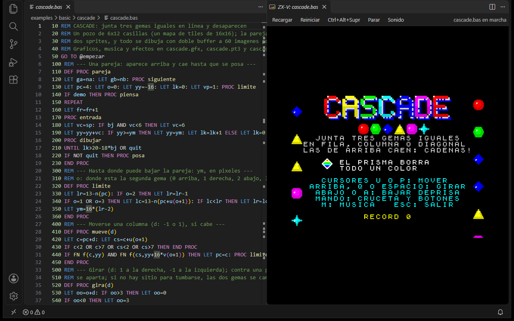
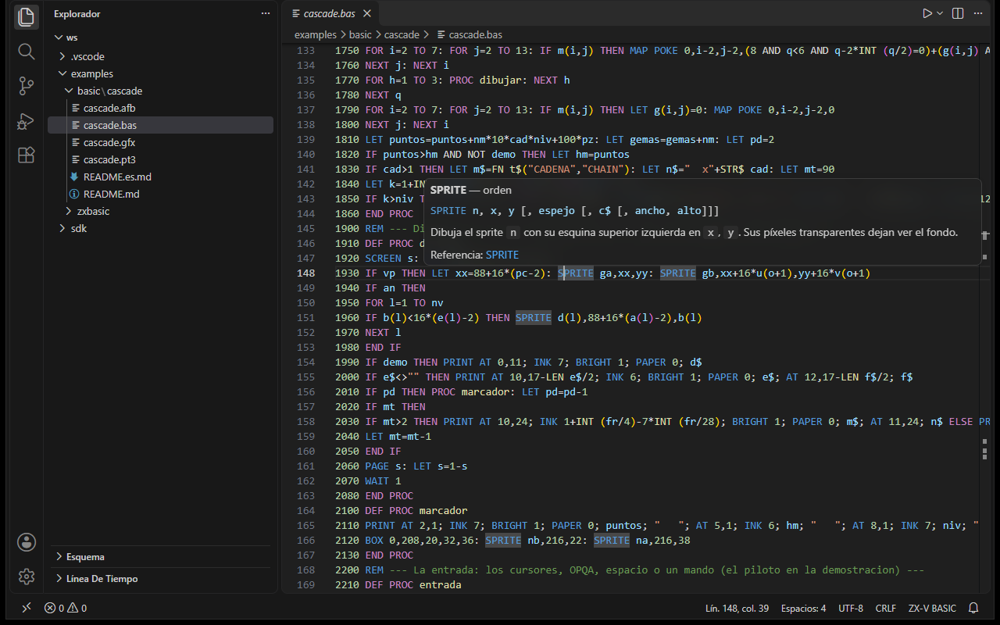
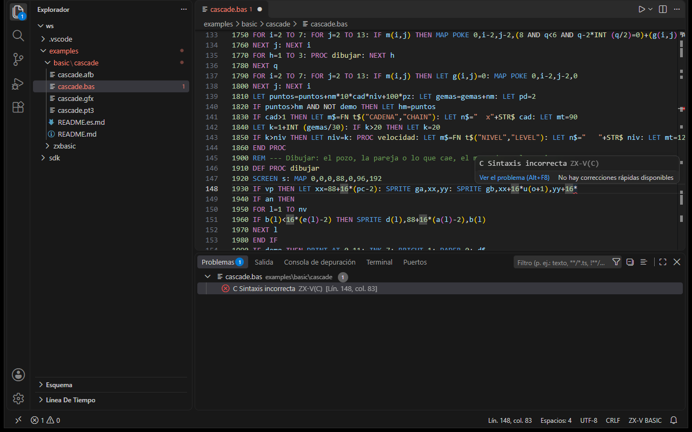
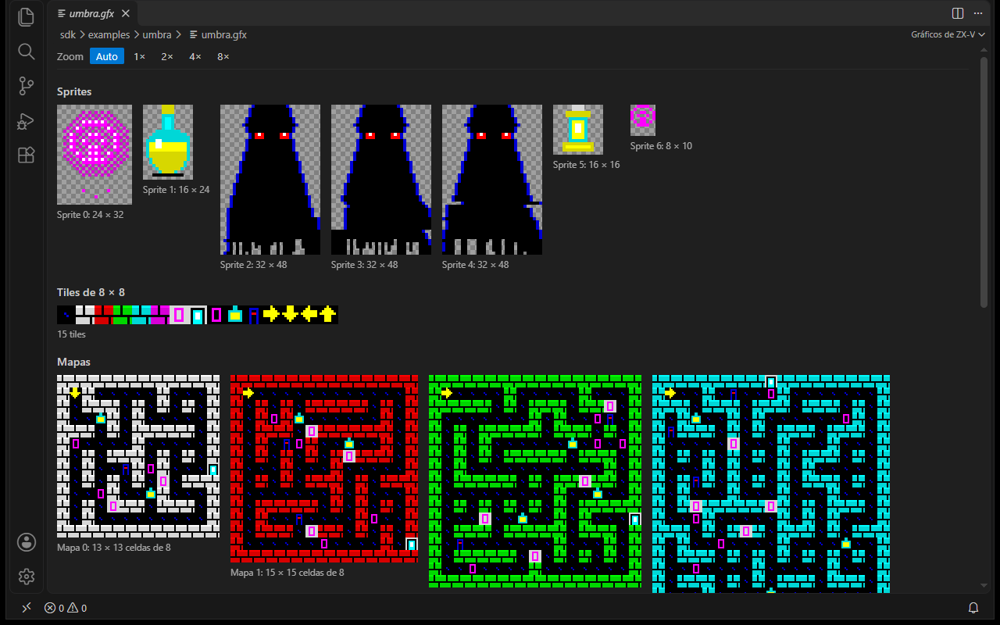
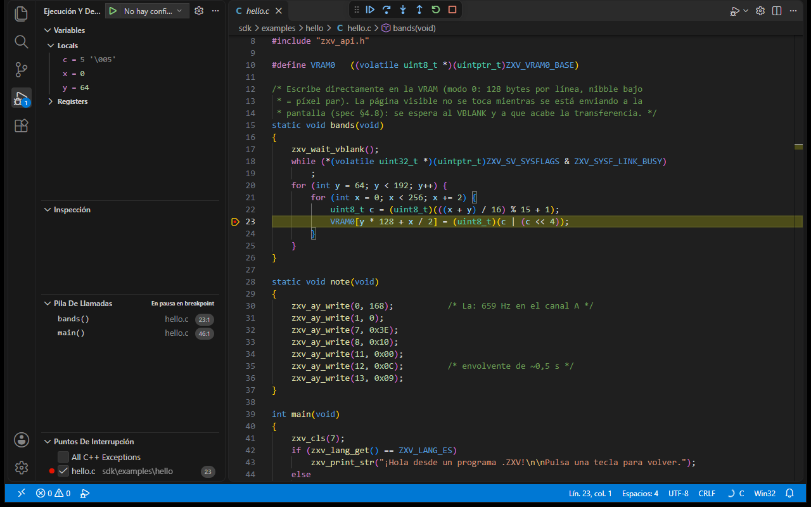

[English](README.md) · **Español**

# ZX-V para Visual Studio Code

Programa para [ZX-V](https://cronomantic.github.io/ZX-V/) desde VS Code: los
dos BASIC con colores y snippets, compilar y ejecutar con las herramientas de
ZX-V, el emulador dentro del editor y depurar programas en C con GDB.



La extensión no lleva las herramientas: usa las que tengas instaladas (una
[release de ZX-V](https://github.com/cronomantic/ZX-V/releases), el SDK, el
compilador de RISC-V, `zxbc`). Solo trae dentro el núcleo web del emulador,
sacado de la release.

## Qué hace

### Los dos BASIC

Los `.bas` pueden ser de dos BASIC distintos, y la extensión los distingue:

| Lenguaje | Qué es |
|---|---|
| **ZX-V BASIC** (`zxv-basic`) | El BASIC de la ROM de la máquina, con números de línea. Se carga tal cual con `LOAD`. |
| **ZX Basic** (`zxv-zxbasic`) | El compilador de Boriel con el target de ZX-V (`zxbc --arch=zxv`) y la librería `zxv.bas`. Sale un `.zxv`. |

Al abrir un `.bas`, su lenguaje sale, por este orden, de:

1. `files.associations`, si lo asocias tú a `zxv-basic` o a `zxv-zxbasic`
   (para patrones: `"**/zxbasic/**/*.bas": "zxv-zxbasic"`);
2. lo que elegiste para ese fichero con **ZX-V: Elegir el dialecto del
   BASIC** (o cambiando el lenguaje en la barra de estado);
3. el ajuste `zxv.basicDialect` de la carpeta (`auto`, `zxv-basic` o
   `zxv-zxbasic`);
4. en `auto`, el contenido: casi todas las líneas con número es el BASIC
   de la ROM; `#include`, `SUB`, `DIM x AS ...`, `ASM`, `DO`... es ZX Basic;
   `DEF PROC` y las etiquetas `@nombre`, el de la ROM.

Cada uno tiene su gramática, sus snippets y su configuración (comentarios,
paréntesis, plegado). Las gramáticas **no están escritas a mano**: las
genera `scripts/gen-grammars.mjs` a partir de las fuentes:

- el BASIC de la ROM: las tablas de palabras clave del tokenizador
  (`rom/src/basic/tokens.c`, `basic.h`) y el índice de palabras clave de la
  referencia (`docs/{es,en}/basic/reference.md`). Como en la máquina, las
  órdenes propias de ZX-V (`MODE`, `SPRITE`...) solo se reconocen al
  principio de una sentencia, y ninguna palabra clave dentro de un nombre;
- ZX Basic: las palabras clave de `zxbc` (`src/zxbc/keywords.py`), sus
  directivas y las órdenes de `zxv.bas` del
  [fork con el target zxv](https://github.com/cronomantic/zxbasic/tree/zxv).

Los snippets del BASIC de la ROM ponen los números de línea siguiendo los de
alrededor (de 10 en 10 si caben): escribe `30 for` y elige el snippet.

**La ayuda al pasar el ratón.** En el BASIC de la ROM, sobre una palabra
clave (también `GOTO`, `DEF PROC` o una etiqueta `@nombre`) sale su
sintaxis, el primer párrafo de su entrada de la referencia y el enlace a la
entrada entera, en español o en inglés según el idioma de VS Code. Lo saca
`gen-grammars.mjs` de `docs/{es,en}/basic/reference.md`. En ZX Basic, sobre
una orden de `zxv.bas` sale su firma y su descripción (en inglés, la de la
librería).



**Los errores mientras escribes.** En el BASIC de la ROM, cada línea se
comprueba como la lee `LOAD` (el mismo tokenizador y la misma comprobación
que el editor de la máquina al pulsar Intro), con el propio BASIC de la ROM
compilado a WebAssembly: `zxv-check.js`, que viene en `zxv-web.zip` desde
ZX-V 0.6.2 (es la orden `zxv-check` de las releases). Marca el error en su
sitio con el informe de la máquina (`C Sintaxis incorrecta`...) y avisa de
los números de línea repetidos. Solo la sintaxis: los errores que salen al
ejecutar los da `RUN`. Se apaga con `zxv.basicCheck`.



> **Con otras extensiones de ZX Basic.** El lenguaje de ZX Basic de esta
> extensión es `zxv-zxbasic`, aparte del `zxbasic` de *ZX-Basic* (jsjlogin)
> y del `borielbasic` de *Boriel Basic* (rtorralba), así que conviven: lo
> propio de esta es lo de ZX-V (`zxv.bas`, el ensamblador de RISC-V,
> compilar con `--arch=zxv`). Con `zxv.claimBasFiles` (activado), los `.bas`
> que VS Code abra como Visual Basic, `zxbasic` o `borielbasic` pasan a uno
> de los BASIC de ZX-V; desactívalo si prefieres que esas extensiones se
> queden con los suyos (y el lenguaje se cambia a mano en la barra de
> estado).

### Proyecto nuevo

**ZX-V: Proyecto nuevo** pregunta el tipo, el nombre y dónde, y crea una
carpeta lista para F5:

| Tipo | Lo que trae |
|---|---|
| C | `main.c`, el `Makefile` de la guía del SDK (con `OPT=-Og` para depurar), `launch.json` con la configuración «ZX-V: GDB» y `c_cpp_properties.json` con las cabeceras del SDK para IntelliSense. Si no sabe dónde está el SDK, lo pregunta (y puede guardarlo en `zxv.sdkPath`). |
| BASIC de la ROM | `NOMBRE.bas` con números de línea y `zxv.basicDialect` en la carpeta |
| ZX Basic | `NOMBRE.bas` con `#include <zxv.bas>` y un bucle a 60 imágenes por segundo con doble buffer |

Luego la abre (en esta ventana, en otra o añadida al espacio de trabajo) con
el fichero principal a la vista.

### Compilar y ejecutar

| Orden | Qué hace |
|---|---|
| **ZX-V: Compilar** | C: `make` en la carpeta del `Makefile` (pasándole `SDK=` con `zxv.sdkPath`). En el SDK, un fichero de `examples/NOMBRE/` compila solo `build/NOMBRE.zxv`. ZX Basic: `zxbc --arch=zxv -o NOMBRE.zxv`. |
| **ZX-V: Ejecutar en zxv-sdl** (F5 en el BASIC de la ROM) | Compila si hace falta y abre el programa en `zxv-sdl`, con su carpeta como tarjeta SD: `--sd CARPETA --type 'LOAD "programa.zxv"'` (con `: RUN` si es un listado). |
| **ZX-V: Ejecutar en el editor** | Lo mismo, en el panel del emulador. |

Los errores de `gcc`, del enlazador y de `zxbc` van al panel de problemas
(problem matchers `$zxv-gcc`, `$zxv-ld` y `$zxbc`). También hay tareas
`"type": "zxv"` para `tasks.json`:

```json
{ "type": "zxv", "action": "make", "file": "${file}", "label": "ZX-V: make" }
{ "type": "zxv", "action": "zxbc", "file": "${file}", "label": "ZX-V: zxbc" }
{ "type": "zxv", "action": "run", "file": "${workspaceFolder}/build/juego.zxv", "label": "ZX-V: jugar" }
```

### El emulador dentro del editor

Un panel con la misma máquina que la versión web (el núcleo de
`zxv-web.zip`), con su BASIC, su sonido, el teclado, el ratón y los mandos.
Al ejecutar un programa, el panel copia a su tarjeta el programa y los
ficheros de su carpeta (`.gfx`, `.pt3`, `.afb`...), lo carga con `LOAD` y,
cuando lo recompilas o guardas el `.bas`, lo vuelve a cargar. La tarjeta del
panel se guarda entre sesiones.

### Publicar en la web

**ZX-V: Publicar en la web** hace la página de un solo juego, la que empieza
sola sin que se vea el BASIC ([la guía](https://github.com/cronomantic/ZX-V/blob/main/docs/es/sdk/web.md)),
con `sdk/tools/mkweb.py` del SDK y el núcleo web que lleva la extensión.
Compila el programa y usa el `game.json` de la carpeta del proyecto; la
primera vez lo crea con el programa, los ficheros que carga (`.gfx`,
`.pt3`, `.afb`...) y el título, para que puedas cambiar el idioma, el borde
o los controles táctiles. Deja la página en `web/` y un `NOMBRE-web.zip`
para subirlo a itch.io, y la abre en el navegador si quieres.

### Vistas previas

Al abrir un fichero de un juego se ve o se oye, en vez de sus bytes:

| Fichero | Lo que se ve |
|---|---|
| `.gfx` | Sus sprites, tiles, mapas (con sus tiles, los volteos y la transparencia de cada celda) y texturas de modo 7, con la paleta de la máquina y un zoom sin suavizar |
| `.pt3`, `.pt2`, `.stc`, `.asc`, `.psg` | Un reproductor: suena en la máquina de verdad (el núcleo web) con `MUSIC PLAY`, `MUSIC PAUSE` y `MUSIC STOP` |
| `.afb`, `.afx` | Un botón por efecto del banco (`SFX n`) |



Se vuelven a cargar al guardar el fichero (desde `zxv-gfx` o `zxv-tracker`,
por ejemplo). Para ver los bytes, **Reabrir el editor con...** > Editor de
texto.

### Depurar C con GDB

El emulador hace de servidor GDB (`zxv-sdl --gdb PUERTO`) y el depurador es
el de la extensión [C/C++](https://marketplace.visualstudio.com/items?itemName=ms-vscode.cpptools)
de Microsoft. En `launch.json`:

```json
{
  "type": "zxv",
  "request": "launch",
  "name": "ZX-V: GDB",
  "program": "${workspaceFolder}/build/hello.elf"
}
```

Compila con `make`, lanza `zxv-sdl` con `--gdb` y el `.zxv` que hay junto al
`.elf`, y conecta GDB (`cppdbg` con `miDebuggerServerAddress`). Al parar, se
cierra el emulador. Para ver las variables paso a paso, compila con `-Og`
(`EXTRA_CFLAGS=-Og` en `zxv.makeArgs`).



Si prefieres verlo todo, **ZX-V: Añadir una configuración para depurar con
GDB** escribe una configuración `cppdbg` normal en `launch.json` y su
`preLaunchTask` (la tarea `gdb-server`) en `tasks.json`.

### Depurar el BASIC de la ROM

Con un listado del BASIC de la ROM abierto, F5 (o el tipo `zxv-basic` en
`launch.json`) lo carga en el panel del emulador y se depura como cualquier
otro lenguaje:

```json
{
  "type": "zxv-basic",
  "request": "launch",
  "name": "ZX-V: BASIC",
  "program": "${file}",
  "stopOnEntry": false
}
```

- **Puntos de ruptura** en una línea, o en una sentencia de la línea
  (Mayús+F9 o el punto en línea), con una condición (`x>10`), un número de
  veces o un mensaje (logpoints, con `{expresión}` dentro).
- **Parar, seguir y paso a paso por sentencias**: cada `:`, `THEN` y `ELSE`
  es un paso, y el editor resalta la sentencia que va a ejecutarse, no la
  línea entera. *Paso a paso* entra en un `GO SUB` o un `PROC`, *paso por
  encima* no entra, *salir* sigue hasta el `RETURN` o el `END PROC`.
- **La pila de llamadas**: los `GO SUB` y los `PROC` en curso.
- **Las variables**: números, cadenas, variables de `FOR` (con su límite, su
  paso y dónde está su `FOR`) y matrices, elemento a elemento.
- **Evaluar expresiones** al pasar el ratón, en Inspección y en la consola
  de depuración: las evalúa la propia ROM, así que valen `FN`, `PEEK`,
  `SCREEN$`...
- **Parar en los errores**, antes de `ON ERROR` o del informe: *Errores sin
  ON ERROR* (de serie) o *Todos los errores*, en la vista de puntos de
  ruptura.

Mientras está parado, la máquina sigue viva (la pantalla, el teclado), con
la música en pausa y el sonido callado; vuelve al seguir. Acabar la sesión
pulsa BREAK.

Necesita un núcleo web cuya ROM tenga el depurador del BASIC (ZX-V 0.7 o
posterior, spec de ZX-V §8.2): con uno anterior, lo dice y no empieza. La
extensión no interpreta el BASIC: habla con la ROM por un buzón en la
memoria, y la ROM evalúa, lista las variables y recorre la pila.

## Ajustes

| Ajuste | Para qué |
|---|---|
| `zxv.toolsPath` | La carpeta de una release de ZX-V, con `zxv-sdl` y `zxv-cli` (si no, el PATH) |
| `zxv.sdkPath` | La carpeta `sdk` de ZX-V, que se pasa a `make` como `SDK=` |
| `zxv.zxbcPath` | `zxbc.exe` de la release del fork (1.19.0-zxv.4 o posterior), o `zxbc.py` (con `zxv.pythonPath`) |
| `zxv.gdbPath` | GDB para RISC-V (si no, `riscv64-unknown-elf-gdb`, `riscv64-elf-gdb` o `gdb-multiarch` del PATH) |
| `zxv.basicDialect` | `auto`, `zxv-basic` o `zxv-zxbasic`, por carpeta |
| `zxv.makeArgs`, `zxv.zxbcArgs`, `zxv.emulatorArgs` | Más argumentos para cada herramienta. `zxv.zxbcArgs` trae `--enable-break` (Esc para el programa; necesita ZX Basic 1.19.0-zxv.4 o posterior, porque en los anteriores estropeaba lo que devuelven `KEY`, `JOY`...) y `-W150 -W170`, que callan los avisos que dan las librerías (también `zxv.bas`) por los parámetros que se leen en ASM y por las funciones que no se llaman |
| `zxv.program` | El `.zxv` de un proyecto en C, si no se adivina |
| `zxv.gdbPort` | El puerto del servidor GDB (1234) |

## Instalarla

Todavía no está en las tiendas: instala el `.vsix` a mano, desde
**Extensiones > ... > Instalar desde VSIX**, o con

```bash
code --install-extension zxv-0.1.0.vsix
```

## Compilarla

```bash
npm install
npm run grammars    # las gramáticas, desde ../ZX-V y ../zxbasic (o --zxv, --zxbasic)
npm run web         # el núcleo web: copia zxv-web.zip de ../ZX-V/build/release/0.6.2
npm test            # pruebas unitarias
npx vsce package    # zxv-0.1.0.vsix
```

`npm run web -- --from RUTA` usa otro `zxv-web.zip` (o una carpeta con él), y
`npm run web -- --download` lo descarga de la
[release v0.6.2](https://github.com/cronomantic/ZX-V/releases/tag/v0.6.2).
Con uno anterior a la 0.6.2, que no trae `zxv-check.js`, `npm run web --
--check RUTA` pone uno compilado aparte (el objetivo `zxv-check-web` de ZX-V
con `emcmake`); sin él, la extensión no marca los errores mientras escribes.

Las pruebas dentro de VS Code (`npm run test:vscode`) compilan y ejecutan los
ejemplos de ZX-V con las herramientas de verdad; ver `test/runTests.ts` para
las variables (`ZXV_TOOLS`, `ZXBC`, `PYTHON`...).

La misma ejecución saca las capturas de este README (`images/screenshots`),
en Windows: con `ZXV_SCREENSHOTS=images/screenshots` y `ZXV_SCREENSHOTS_LANG`
(`en` o `es`) deja VS Code en cada escena y captura su ventana. En
`ZXV_TEST_EXTENSIONS_DIR` tiene que estar C/C++ (para la de GDB) y, para `es`,
el paquete de idioma español; la primera vez en `es` salen en inglés, porque
VS Code apunta el paquete de idioma tarde para ese arranque.

## Publicarla

`.github/workflows/publish.yml` la publica en el VS Code Marketplace y en
Open VSX, y deja el `.vsix` en una release de GitHub, cuando se sube una
etiqueta con la versión de `package.json`:

```bash
git tag v0.1.0 && git push origin v0.1.0
```

Sin tokens: las dos tiendas confían en ese workflow (publicación de confianza
con OIDC), que corre en el entorno `publish` del repositorio. El núcleo web
lo descarga de la release de ZX-V que dice `scripts/fetch-web.mjs`. Open VSX
solo se publica con la variable del repositorio `PUBLISH_OPENVSX = true`. Se
puede repetir sin miedo: lo que ya está en una tienda se salta.

## Licencia

MIT. El núcleo web de `media/web` es de ZX-V, con sus licencias en esa
carpeta.
