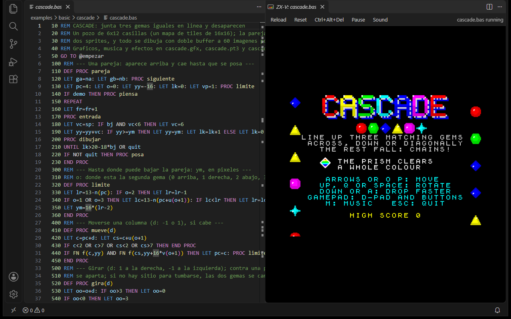
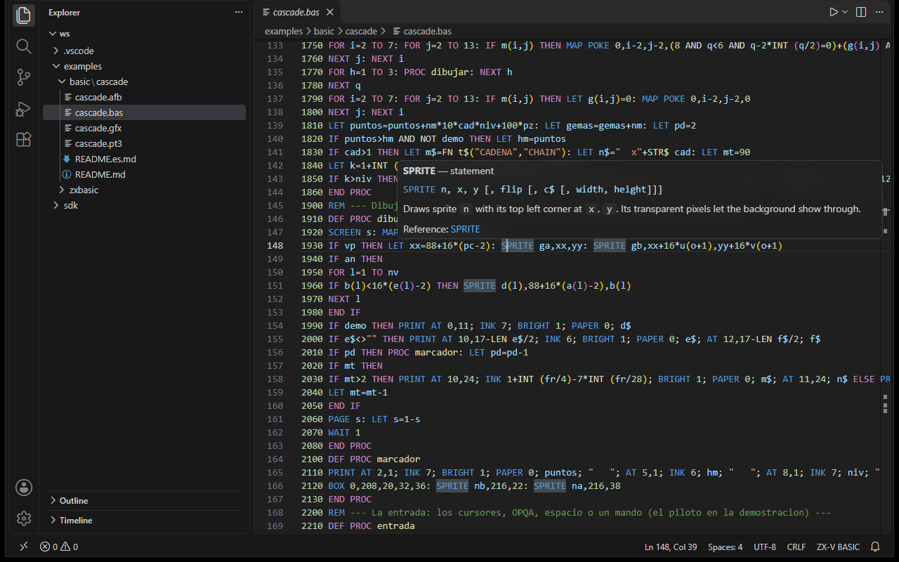
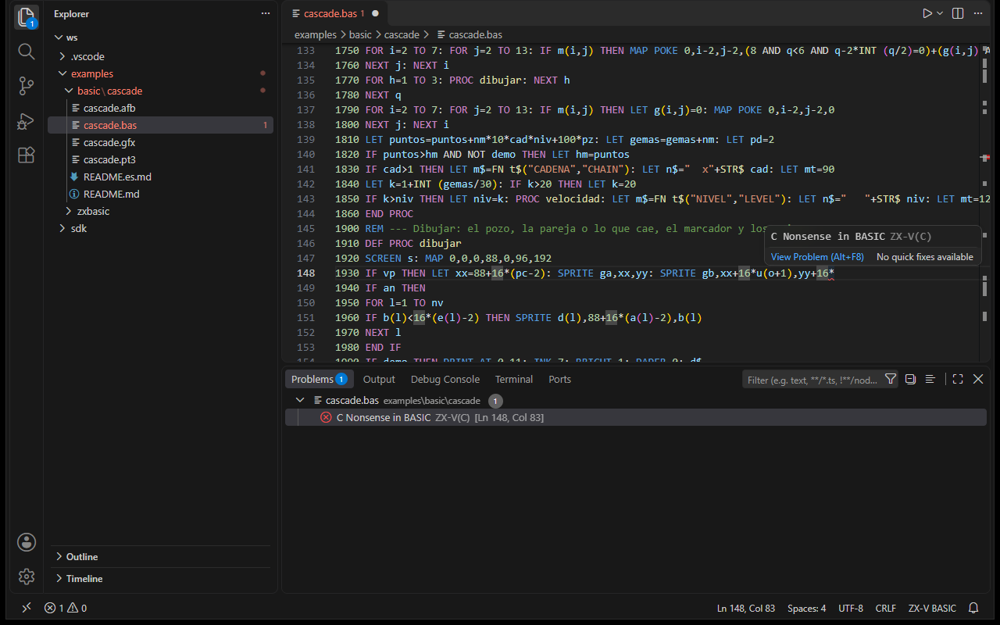
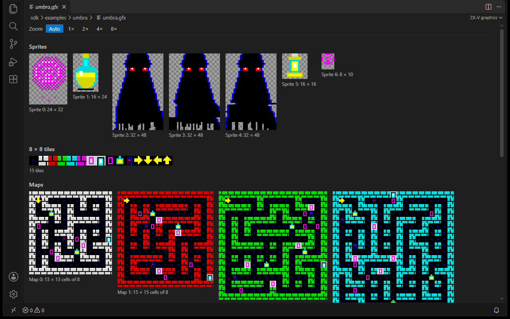
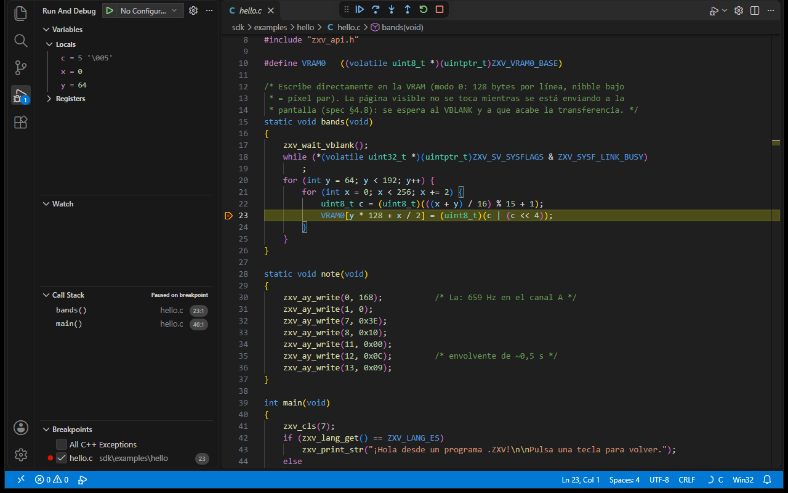

**English** · [Español](README.es.md)

# ZX-V for Visual Studio Code

Program [ZX-V](https://cronomantic.github.io/ZX-V/) from VS Code: both
BASICs with colours and snippets, build and run with the ZX-V tools, the
emulator inside the editor and C debugging with GDB.



The extension does not bundle the tools: it uses the ones you have installed
(a [ZX-V release](https://github.com/cronomantic/ZX-V/releases), the SDK, the
RISC-V compiler, `zxbc`). It only carries the emulator web core, taken from
the release.

## What it does

### Both BASICs

`.bas` files can be in two different BASICs, and the extension tells them
apart:

| Language | What it is |
|---|---|
| **ZX-V BASIC** (`zxv-basic`) | The machine ROM BASIC, with line numbers. It is loaded as it is with `LOAD`. |
| **ZX Basic** (`zxv-zxbasic`) | Boriel's compiler with the ZX-V target (`zxbc --arch=zxv`) and the `zxv.bas` library. It builds a `.zxv`. |

When a `.bas` is opened, its language comes from, in this order:

1. `files.associations`, if you map it to `zxv-basic` or `zxv-zxbasic` (for
   globs: `"**/zxbasic/**/*.bas": "zxv-zxbasic"`);
2. what you chose for that file with **ZX-V: Choose the BASIC dialect** (or
   by changing the language in the status bar);
3. the folder setting `zxv.basicDialect` (`auto`, `zxv-basic` or `zxv-zxbasic`);
4. in `auto`, the content: almost every line numbered is the ROM BASIC;
   `#include`, `SUB`, `DIM x AS ...`, `ASM`, `DO`... is ZX Basic;
   `DEF PROC` and `@name` labels, the ROM one.

Each one has its grammar, snippets and language configuration (comments,
brackets, folding). The grammars are **not written by hand**:
`scripts/gen-grammars.mjs` generates them from the sources:

- the ROM BASIC: the tokenizer keyword tables (`rom/src/basic/tokens.c`,
  `basic.h`) and the keyword index of the reference
  (`docs/{en,es}/basic/reference.md`). As on the machine, the ZX-V
  statements (`MODE`, `SPRITE`...) are only recognised at the start of a
  statement, and no keyword inside a name;
- ZX Basic: the `zxbc` keywords (`src/zxbc/keywords.py`), its directives and
  the `zxv.bas` commands of the
  [fork with the zxv target](https://github.com/cronomantic/zxbasic/tree/zxv).

The ROM BASIC snippets number their lines after the ones around them (in
tens if they fit): type `30 for` and pick the snippet.

**Help on hover.** In the ROM BASIC, over a keyword (also `GOTO`,
`DEF PROC` or a `@name` label) you get its syntax, the first paragraph of
its reference entry and a link to the whole entry, in English or Spanish
after the VS Code language. `gen-grammars.mjs` takes it from
`docs/{en,es}/basic/reference.md`. In ZX Basic, over a `zxv.bas` command
you get its signature and description (in English, the library's).



**Errors as you type.** In the ROM BASIC, each line is checked as `LOAD`
reads it (the same tokenizer and the same check as the machine editor when
you press Enter), with the ROM BASIC itself compiled to WebAssembly:
`zxv-check.js`, in `zxv-web.zip` since ZX-V 0.6.2 (it is the `zxv-check`
command of the releases). It marks the error in place with the machine
report (`C Nonsense in BASIC`...) and warns about repeated line numbers.
Only syntax: the errors that come up when running come from `RUN`. Turn it
off with `zxv.basicCheck`.



> **With other ZX Basic extensions.** This extension's ZX Basic language is
> `zxv-zxbasic`, apart from the `zxbasic` of *ZX-Basic* (jsjlogin) and the
> `borielbasic` of *Boriel Basic* (rtorralba), so they live together: what
> this one adds is the ZX-V part (`zxv.bas`, RISC-V assembler, building with
> `--arch=zxv`). With `zxv.claimBasFiles` (on), `.bas` files that VS Code
> opens as Visual Basic, `zxbasic` or `borielbasic` switch to one of the ZX-V
> BASICs; turn it off if you prefer those extensions to keep theirs (and
> change the language by hand in the status bar).

### New project

**ZX-V: New project** asks for the kind, the name and where, and creates a
folder ready for F5:

| Kind | What it brings |
|---|---|
| C | `main.c`, the `Makefile` of the SDK guide (with `OPT=-Og` to debug), `launch.json` with the "ZX-V: GDB" configuration and `c_cpp_properties.json` with the SDK headers for IntelliSense. If it does not know where the SDK is, it asks (and can save it in `zxv.sdkPath`). |
| ZX-V ROM BASIC | `NAME.bas` with line numbers and `zxv.basicDialect` in the folder |
| ZX Basic | `NAME.bas` with `#include <zxv.bas>` and a 60 frames per second loop with double buffer |

Then it opens it (in this window, in a new one or added to the workspace)
with the main file in view.

### Build and run

| Command | What it does |
|---|---|
| **ZX-V: Build** | C: `make` in the `Makefile` folder (passing `SDK=` from `zxv.sdkPath`). In the SDK, a file in `examples/NAME/` builds only `build/NAME.zxv`. ZX Basic: `zxbc --arch=zxv -o NAME.zxv`. |
| **ZX-V: Run in zxv-sdl** (F5 in ROM BASIC) | Builds if needed and opens the program in `zxv-sdl`, with its folder as SD card: `--sd FOLDER --type 'LOAD "program.zxv"'` (plus `: RUN` for a listing). |
| **ZX-V: Run in the editor** | The same, in the emulator panel. |

`gcc`, linker and `zxbc` errors go to the Problems panel (problem matchers
`$zxv-gcc`, `$zxv-ld` and `$zxbc`). There are also `"type": "zxv"` tasks for
`tasks.json`:

```json
{ "type": "zxv", "action": "make", "file": "${file}", "label": "ZX-V: make" }
{ "type": "zxv", "action": "zxbc", "file": "${file}", "label": "ZX-V: zxbc" }
{ "type": "zxv", "action": "run", "file": "${workspaceFolder}/build/game.zxv", "label": "ZX-V: play" }
```

### The emulator inside the editor

A panel with the same machine as the web version (the `zxv-web.zip` core),
with its BASIC, sound, keyboard, mouse and joysticks. When you run a program,
the panel copies the program and the files of its folder (`.gfx`, `.pt3`,
`.afb`...) to its card, loads it with `LOAD` and loads it again when you
rebuild it or save the `.bas`. The panel card is kept between sessions.

### Publishing on the web

**ZX-V: Publish on the web** makes the page of a single game, the one that
starts by itself without showing the BASIC ([the guide](https://github.com/cronomantic/ZX-V/blob/main/docs/en/sdk/web.md)),
with the SDK's `sdk/tools/mkweb.py` and the web core the extension carries.
It builds the program and uses the `game.json` of the project folder; the
first time it creates it with the program, the files it loads (`.gfx`,
`.pt3`, `.afb`...) and the title, so you can change the language, the
border or the touch controls. It leaves the page in `web/` and a
`NAME-web.zip` to upload to itch.io, and opens it in the browser if you want.

### Previews

Opening a game file shows or plays it, instead of its bytes:

| File | What you get |
|---|---|
| `.gfx` | Its sprites, tiles, maps (with their tiles, flips and the transparency of each cell) and mode 7 textures, with the machine palette and an unsmoothed zoom |
| `.pt3`, `.pt2`, `.stc`, `.asc`, `.psg` | A player: it plays on the real machine (the web core) with `MUSIC PLAY`, `MUSIC PAUSE` and `MUSIC STOP` |
| `.afb`, `.afx` | A button for each effect of the bank (`SFX n`) |



They load again when the file is saved (from `zxv-gfx` or `zxv-tracker`,
for example). To see the bytes, **Reopen Editor With...** > Text Editor.

### Debugging C with GDB

The emulator is the GDB server (`zxv-sdl --gdb PORT`) and the debugger is the
one in Microsoft's [C/C++](https://marketplace.visualstudio.com/items?itemName=ms-vscode.cpptools)
extension. In `launch.json`:

```json
{
  "type": "zxv",
  "request": "launch",
  "name": "ZX-V: GDB",
  "program": "${workspaceFolder}/build/hello.elf"
}
```

It builds with `make`, starts `zxv-sdl` with `--gdb` and the `.zxv` next to
the `.elf`, and connects GDB (`cppdbg` with `miDebuggerServerAddress`). When
you stop, the emulator closes. To see variables step by step, build with
`-Og` (`EXTRA_CFLAGS=-Og` in `zxv.makeArgs`).



If you prefer to see everything, **ZX-V: Add a GDB debug configuration**
writes a plain `cppdbg` configuration to `launch.json` and its
`preLaunchTask` (the `gdb-server` task) to `tasks.json`.

## Settings

| Setting | What for |
|---|---|
| `zxv.toolsPath` | The folder of a ZX-V release, with `zxv-sdl` and `zxv-cli` (otherwise, the PATH) |
| `zxv.sdkPath` | The ZX-V `sdk` folder, passed to `make` as `SDK=` |
| `zxv.zxbcPath` | `zxbc.exe` from the fork release (1.19.0-zxv.4 or later), or `zxbc.py` (with `zxv.pythonPath`) |
| `zxv.gdbPath` | GDB for RISC-V (otherwise `riscv64-unknown-elf-gdb`, `riscv64-elf-gdb` or `gdb-multiarch` on the PATH) |
| `zxv.basicDialect` | `auto`, `zxv-basic` or `zxv-zxbasic`, per folder |
| `zxv.makeArgs`, `zxv.zxbcArgs`, `zxv.emulatorArgs` | More arguments for each tool. `zxv.zxbcArgs` brings `--enable-break` (Esc stops the program; it needs ZX Basic 1.19.0-zxv.4 or later, since in older ones it broke what `KEY`, `JOY`... return) and `-W150 -W170`, which hide the warnings the libraries (`zxv.bas` too) give for parameters read in ASM and for functions not called |
| `zxv.program` | The `.zxv` of a C project, if it cannot be guessed |
| `zxv.gdbPort` | The GDB server port (1234) |

## Installing it

It is not in the stores yet: install the `.vsix` by hand, from
**Extensions > ... > Install from VSIX**, or with

```bash
code --install-extension zxv-0.1.0.vsix
```

## Building it

```bash
npm install
npm run grammars    # the grammars, from ../ZX-V and ../zxbasic (or --zxv, --zxbasic)
npm run web         # the web core: copies zxv-web.zip from ../ZX-V/build/release/0.6.2
npm test            # unit tests
npx vsce package    # zxv-0.1.0.vsix
```

`npm run web -- --from PATH` uses another `zxv-web.zip` (or a folder with
it), and `npm run web -- --download` downloads it from the
[v0.6.2 release](https://github.com/cronomantic/ZX-V/releases/tag/v0.6.2).
With one older than 0.6.2, which has no `zxv-check.js`, `npm run web --
--check PATH` adds one built separately (the `zxv-check-web` target of ZX-V
with `emcmake`); without it, the extension does not mark errors as you type.

The tests inside VS Code (`npm run test:vscode`) build and run the ZX-V
examples with the real tools; see `test/runTests.ts` for the variables
(`ZXV_TOOLS`, `ZXBC`, `PYTHON`...).

The same run takes the screenshots of this README (`images/screenshots`),
on Windows: with `ZXV_SCREENSHOTS=images/screenshots` and
`ZXV_SCREENSHOTS_LANG` (`en` or `es`) it sets up each scene in VS Code and
captures its window. `ZXV_TEST_EXTENSIONS_DIR` must have C/C++ (for the GDB
one) and, for `es`, the Spanish language pack; the first `es` run comes out
in English, because VS Code registers the language pack too late for it.

## Publishing it

`.github/workflows/publish.yml` publishes it on the VS Code Marketplace and
Open VSX, and leaves the `.vsix` in a GitHub release, when a tag with the
`package.json` version is pushed:

```bash
git tag v0.1.0 && git push origin v0.1.0
```

No tokens: both stores trust that workflow (trusted publishing with OIDC),
which runs in the repository's `publish` environment. It downloads the web
core from the ZX-V release that `scripts/fetch-web.mjs` names. Open VSX is
only published to with the repository variable `PUBLISH_OPENVSX = true`. It
can be re-run safely: what a store already has is skipped.

## Licence

MIT. The web core in `media/web` belongs to ZX-V, with its licences in that
folder.
